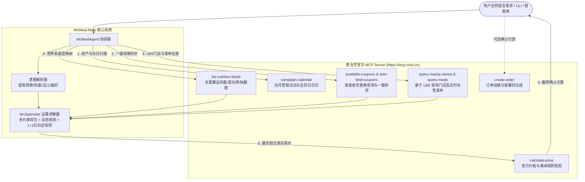

# McMeal-Mate 麦当劳 MCP 集成说明文档

本文档详细阐述 `McMeal-Mate`（麦膳精算师）如何接入并深度融合麦当劳中国 MCP（Model Context Protocol）服务，涵盖服务架构、调用的 Tool 清单、全链路时序图与业务价值。

---

## 一、 系统架构与 MCP 拓扑关系

`McMeal-Mate` 将大语言模型（LLM）的自然语言意图理解、运筹学多约束背包优化算法（McKnapsack Optimizer）与麦当劳官方 MCP Server 深度打通。



---

## 二、 实际调用的麦当劳 MCP Tool 列表与业务价值

| 序号 | MCP Tool 名称 | 工具中文描述 | 在 McMeal-Mate 中的具体业务作用与价值 |
|:---:|:---|:---|:---|
| 1 | `now-time-info` | 服务器时间查询 | 确定当前时间基准，判断是否处于早餐时段（10:30前）、午晚餐时段或深夜夜市，确保餐品时效性。 |
| 2 | `campaign-calendar` | 营销活动日历 | 自动识别当前促销周期（如“周一麦麦会员日买一送一”、“周三麦乐送免配日”），将营销活动纳入目标函数加权。 |
| 3 | `available-coupons` | 麦麦省优惠券查询 | 动态扫描麦当劳麦麦省可用优惠券，识别买一送一、单品立减等优惠机会。 |
| 4 | `auto-bind-coupons` | 麦麦省一键领券 | 点餐前零点击全自动绑定所有可用券包，解决用户“忘记领券多花冤枉钱”的痛点。 |
| 5 | `query-nearby-stores` | 查询附近可用门店 | 根据用户指定城市（默认上海）与地理位置关键词，获取最近可用餐厅的 `storeCode` 与 `beCode`。 |
| 6 | `query-meals` | 门店在售餐品列表 | 获取选定餐厅当前精确的分类、餐品编码、基础价格及售罄状态，作为背包算法的候选物品池。 |
| 7 | `list-nutrition-foods` | 餐品营养成分列表 | 麦当劳独家权威营养素底库（涵盖能量大卡、蛋白质、脂肪、碳水、钠等），为身材管控、控卡、增肌提供算力支撑。 |
| 8 | `calculate-price` | 商品真实价格核算 | 将运筹优化器推荐的餐品组合与券码发送至官方进行二次算价核验，确保分毫不差。 |
| 9 | `create-order` | 创建订单 | 用户满意推荐组合后，一键生成正式订单与取餐二维码/支付链接，实现从对话到消费的无缝闭环。 |

---

## 三、 全链路执行时序图

```mermaid
sequenceDiagram
    autonumber
    actor User as 用户 (开发者/麦门信徒)
    participant Agent as McMealAgent
    participant MCP as 麦当劳 MCP Server
    participant Opt as McOptimizer (运筹算法)

    User->>Agent: "预算25元，想吃汉堡和饮料，要划算"
    Note over Agent: 意图解析: Budget<=25, Req: [MAIN, DRINK]
    
    Agent->>MCP: auto-bind-coupons() 一键绑定券包
    MCP-->>Agent: 返回领券成功结果
    
    Agent->>MCP: campaign-calendar() 获取营销日历
    MCP-->>Agent: 返回当日活动 (如周一会员日特惠)

    Agent->>MCP: query-nearby-stores("上海", "人民广场")
    MCP-->>Agent: 返回最近餐厅 storeCode: 1450713
    
    Agent->>MCP: query-meals(storeCode) & list-nutrition-foods()
    MCP-->>Agent: 返回实时在售餐品价格表 + 官方营养素映射表
    
    Agent->>Opt: 输入 (在售菜单, 可用优惠券, 营养库, 约束条件)
    Note over Opt: 求解多约束背包问题：<br/>1. 枚举 1+1 随心配红白区组合<br/>2. 组合单品券与满减券深度折扣<br/>3. 过滤卡路里/蛋白质/品类约束<br/>4. 帕累托最优分选 Top 3
    Opt-->>Agent: 返回候选最优配餐方案

    Agent->>MCP: calculate-price(items, couponIds)
    MCP-->>Agent: 官方最终核价: payable_amount, discount_amount
    
    Agent->>User: 渲染输出高颜值推荐报告 (省钱王、均衡餐、控卡伴侣)
```

---

## 四、 核心算法业务价值体现

1. **组合折扣最大化（打破信息差）**：
   普通用户点餐往往直接单点，比如“双层吉士堡(¥23.5) + 中可乐(¥10.0) + 中薯条(¥14.5) = ¥48.0”。
   `McMeal-Mate` 的算法会自动识别：
   - 双层吉士汉堡与饮品可命中 **随心配 1+1 规则（立省为 ¥13.9）**；
   - 剩余的中薯条应用 **麦麦省买一送一券（减 ¥14.5）**；
   - 最终实付仅需 **¥13.9**，**立省 ¥34.1（相当于 2.8 折）**！
2. **办公室外送免配门槛最优凑单 (Delivery Pooling)**：
   麦乐送免配送费起送门槛为 39 元。当用户选购总额仅为 26 元时，算法通过单双品凑单规划，精准推荐差额最小、性价比最高的小食（如香芋派或 5 块麦乐鸡），避免“为了凑 13 元却多花了 25 元”的浪费。
3. **高健壮性沙箱机制**：
   系统设计了完备的在线/离线双通道机制。无论在有网络和 Token 的生产环境，还是在无凭证的离线开发测试环境下，均能通过官方基准数据保证 100% 健壮运行。
