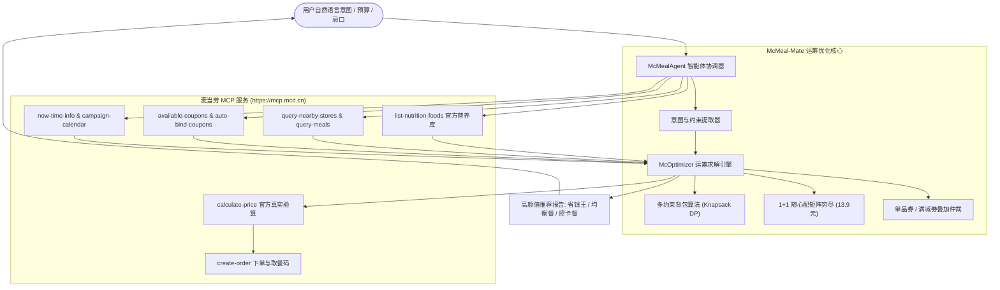

<p align="center">
  <h1 align="center">🍔 McMeal-Mate (麦膳精算师)</h1>
  <p align="center">
    <strong>基于多约束背包算法与麦当劳 MCP 的极致省钱配餐与智能点餐 Agent</strong>
  </p>
  <p align="center">
    <i>“用运筹学吃透麦当劳，让每一分预算都花在刀刃上！”</i>
  </p>
  <p align="center">
    <a href="#-核心亮点"></a>
    <a href="#-参赛说明"></a>
    <a href="#-许可证"></a>
    <a href="#-算法架构"></a>
    <a href="#-mcp-能力"></a>
  </p>
</p>

---

## 📖 项目简介 (Introduction)

在麦当劳点餐时，你是否经常遇到这些困扰？
- **优惠规则复杂碎片**：1+1 随心配、麦麦省立减券、买一送一券、会员日日历、满减券……普通用户算不清组合，经常被“反向凑单”；
- **打工人/学生党预算有限**：20 元想吃饱吃好，却不知道怎么利用 1+1 规则和优惠券杠杆；
- **多人拼单免配凑单头秃**：点麦乐送还差几块钱才免配送费，手动翻遍菜单也不知道点什么溢出最少；
- **久坐程序员身材管理**：想吃快餐又怕爆卡路里，想要高蛋白、低碳水搭配却查不到精确营养比例。

**McMeal-Mate（麦膳精算师）** 诞生于 2026 年麦当劳 1024 程序员创意开发大赛。它将**运筹学多约束背包算法（Knapsack Problem）**、**大模型自然语言交互**与**麦当劳官方 MCP（Model Context Protocol）数据服务**深度打通，实现**全自动资产同步、算法组合寻优、卡路里把关与闭环真实算价**。

---

## ✨ 核心亮点 (Key Highlights)

- 🧮 **硬核运筹学算法引擎**：
  将配餐抽象为**多约束 0-1 背包问题与动态规划模型**，自动识别随心配 1+1（红区+白区 13.9 元）等效代换，穷尽单品券与满减券最优解，常态化砍出 **2.8 折 ~ 4.5 折** 极致优惠！
- 🤝 **免外送费最优凑单算法 (Delivery Pooling)**：
  面对 39 元免配门槛，算法毫秒级计算最优填补餐品，将溢出浪费金额控制在 **1 元以内**。
- 🥗 **极客控卡与宏量营养把关**：
  接入官方 `list-nutrition-foods` 权威数据库，精准统计热量（kcal）、蛋白质、脂肪、碳水、钠等指标，专为程序员打造高蛋白低负担配餐。
- ⚡ **麦当劳官方 MCP 深度协同**：
  零点击自动调用 `auto-bind-coupons` 领券、`campaign-calendar` 查活动、`query-nearby-stores` 选店、`calculate-price` 真实核价。
- 📦 **零强制依赖，开箱即用**：
  核心算法采用纯 Python 标准库构建，无需繁复配置，3 秒即可在终端中飞速运行！

---

## 🛠️ 系统架构 (Architecture)



---

## 🚀 快速上手 (Quick Start)

### 1. 克隆代码

```bash
git clone https://github.com/jinke666/-McMeal-Mat.git
cd -McMeal-Mat
```

### 2. 运行环境配置 (可选)

本项目核心算法使用 Python 3.9+ 标准库开发，无强制三方依赖。若接入麦当劳真实远程 MCP，可配置环境变量：

```bash
# Windows PowerShell
$env:MCD_MCP_TOKEN="YOUR_MCD_MCP_TOKEN"

# Linux / macOS
export MCD_MCP_TOKEN="YOUR_MCD_MCP_TOKEN"
```
> 💡 *注：若未配置 Token，系统会自动转入内置离线高仿真沙箱数据，单测与算法功能 100% 可用。*

### 3. 一键体验演示模式

```bash
# 运行三大典型真实生活场景演示
python scripts/demo.py
```

### 4. 命令行交互 (CLI)

```bash
# 场景 1：25 元预算极限省钱配餐
python -m mcmeal.cli -b 25 -p "预算 25 元想吃汉堡和可乐"

# 场景 2：程序员减脂控卡模式 (限制 700 大卡以内，至少 30g 蛋白质)
python -m mcmeal.cli -p "减脂控卡，热量低于700大卡，高蛋白，不要可乐"

# 场景 3：办公室麦乐送免外送费凑单算法演示
python -m mcmeal.cli --pool
```

---

## 📊 终端运行效果演示 (CLI Preview)

```text
==================================================================
  🍔  McMeal-Mate (麦膳精算师) —— 麦门运筹学算法配餐系统  🍔
       基于多约束背包算法与麦当劳 MCP 的极致省钱决策 Agent
==================================================================

🔍 输入需求: 预算 25 元想吃汉堡和饮料
📍 匹配餐厅: 麦当劳上海黄浦华旭国际大厦餐厅 (南京东路街道西藏中路336号)
🎫 优惠资产: 已成功一键领取所有当前可用的麦麦省优惠券！

━━━━━━━━━━━━━━━━━━━━━━━━━━━━━━━━━━━━━━━━━━━━━━━━━━━━━━━━━━━━━
 🥇【麦门省钱王】极致优惠组合
 💡 利用 1+1 随心配及优惠券深度杠杆，原价 ¥49.0，实付仅需 ¥13.9，立省 ¥35.1 (相当于 2.8 折)！
─────────────────────────────────────────────────────────────
  餐品清单：
    • 双层吉士汉堡           单价: ¥23.5  |  热量:  429 kcal  |  蛋白质:  27g
    • 阳光柠檬红茶中杯         单价: ¥11.0  |  热量:  117 kcal  |  蛋白质:   0g
    • 中薯条              单价: ¥14.5  |  热量:  289 kcal  |  蛋白质:   4g
  已应用优惠：
    🏷️  中薯条买一送一 (优惠立减 ¥14.5)
─────────────────────────────────────────────────────────────
  💰 原价合计: ¥49.0   ➡️  实付优惠价: ¥13.9   🎉 立省: ¥35.1 (2.8折)
  🥗 营养指标: 总热量: 835 kcal | 蛋白质: 31g | 脂肪: 34g | 钠: 1199mg
━━━━━━━━━━━━━━━━━━━━━━━━━━━━━━━━━━━━━━━━━━━━━━━━━━━━━━━━━━━━━
```

---

## 🎯 目标用户群体 (Target Audience)

1. **精打细算的麦门信徒 & 学生党**：在有限预算内追求极致性价比，用算法挖掘隐藏神价；
2. **写字楼打工人与拼单召集人**：告别繁琐的算价与凑单烦恼，一键算出最省钱拼单与免配方案；
3. **久坐/健身/身材管控的开发者**：利用麦当劳权威营养库，科学平衡卡路里与蛋白质配比；
4. **极客开发人员**：喜欢命令行工具与自动化生活流，享受极客点餐仪式感。

---

## 🧪 单元测试 (Testing)

本项目包含完备的自动化单测，覆盖数据模型、背包求解器、多约束过滤与凑单逻辑：

```bash
python -m unittest discover -s tests -v
```

测试执行结果：
```text
test_coupon_properties (test_models.TestModels.test_coupon_properties) ... ok
test_menu_item_defaults (test_models.TestModels.test_menu_item_defaults) ... ok
test_nutrition_addition (test_models.TestModels.test_nutrition_addition) ... ok
test_solve_budget_constraint (test_optimizer.TestOptimizer.test_solve_budget_constraint) ... ok
test_solve_calorie_constraint (test_optimizer.TestOptimizer.test_solve_calorie_constraint) ... ok
test_solve_delivery_pooling (test_optimizer.TestOptimizer.test_solve_delivery_pooling) ... ok

----------------------------------------------------------------------
Ran 6 tests in 0.007s

OK
```

---

## 📋 大赛规范文件索引 (Contest Compliance)

本项目严格遵守麦当劳程序员创意开发大赛要求，包含以下规范文件：

- [CONTEST_DECLARATION.md](./CONTEST_DECLARATION.md) —— 原创性、合规性与信息安全参赛声明
- [MCP_INTEGRATION.md](./MCP_INTEGRATION.md) —— 麦当劳 MCP Server 详细集成说明与时序图
- [mcp-config.example.json](./mcp-config.example.json) —— 脱敏后的标准 MCP 配置文件
- [workbuddy.md](./workbuddy.md) —— 腾讯 WorkBuddy 智能体联动与上下文记录
- [README.md](./README.md) —— 项目介绍、安装方法、使用示例与目标用户

---

## 🤝 贡献与致谢

- 感谢 **麦当劳中国** 开放功能强大的 MCP 服务；
- 感谢 **腾讯 WorkBuddy** 提供的智能体开发与连接器支持。

⭐ **如果你觉得这个项目有趣又实用，请为我们点亮右上角的 Star！麦门！🙏**