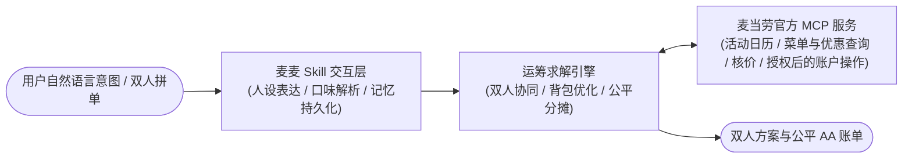

<p align="center">
  <h1 align="center">🍔 麦麦搭子 McMeal-Mate</h1>
  <p align="center">
    <strong>低对话成本、会记住明确偏好、核对优惠与价格的 AI 点餐搭子 Skill</strong>
  </p>
  <p align="center">
    <i>“用运筹学吃透麦当劳，多人点餐不纠结，让每一分预算都花在刀刃上！”</i>
  </p>
  <p align="center">
    <a href="#-核心亮点"></a>
    <a href="#-核心亮点"></a>
    <a href="#-系统架构与-skill-设计"></a>
    <a href="#-系统架构与-skill-设计"></a>
    <a href="#-系统架构与-skill-设计"></a>
  </p>
</p>

---

## 📖 项目简介 (Introduction)

在麦当劳点餐时，你是否经常遇到这些困扰？
- **优惠规则复杂碎片**：1+1 随心配、麦麦省立减券、买一送一券、会员日日历、满减券……普通用户算不清组合，经常被“反向凑单”；
- **多人/双人拼单算账头秃**：同事或情侣一起点餐，“一个吃辣一个不吃辣，他有5元券我有免配券”，共享小食怎么摊？最终怎么算才公平、谁也不占谁便宜？
- **想尝新品却怕踩雷**：菜单里不知道哪些是真正当季上新，缺少可验证的官方新品推荐；
- **久坐程序员身材管理**：想吃快餐又怕爆卡路里，想要高蛋白、低碳水搭配却查不到精确营养比例。

**麦麦搭子 (McMeal-Mate)** 诞生于 2026 年麦当劳 1024 程序员创意开发大赛。它是一个有活人感、认真诚实的虚拟店员 **Skill**，除多约束配餐算法与麦当劳 MCP 接入外，项目强调**低摩擦点餐**：尽可能从一句自然语言中提取条件、优先给一个首选、复用本轮已确认的信息，并在用户反馈后只调整相关条件。双人协同与公平分摊作为进阶能力保留。

---

## ✨ 核心亮点 (Key Highlights)

- 👥 **双人/多人协同点餐与公平分摊 (核心差异化)**：
  - 独立输入并满足双方的口味、忌口（如一人吃辣一人不吃辣、一人要热饮）；
  - 自动优选双方都能接受的**团队共享小食**（如买一送一中薯条、小食盒）；
  - **数学级公平分摊算法**：共享小食人均等额平摊，整单优惠与满减按个人基准原价权重科学抵扣，生成精准到角分的 AA 微信转账账单！
- 🧮 **硬核运筹学背包优化引擎**：
  将配餐抽象为**多约束 0-1 背包问题与动态规划模型**，自动识别随心配 1+1（红区+白区 13.9 元）等效代换，穷尽单品券与满减券最优解，常态化砍出 **2.8 折 ~ 4.5 折** 极致优惠！
- 🆕 **基于官方实时标签的新品发现 (Verifiable New Arrivals)**：
  对接真实 `query-meals` 接口，自动捕获官方携带 `"tags": ["上新"]` 的当季新品（如龙焰鸡腿堡、心形薯饼），让用户尝鲜有据可查。
- 🤝 **免外送费最优凑单算法 (Delivery Pooling)**：
  面对 39 元免配门槛，算法毫秒级计算最优填补餐品，将溢出浪费金额控制在 **1 元以内**。
- 🥗 **极客控卡与宏量营养把关**：
  接入官方 `list-nutrition-foods` 160 款权威数据库，精准统计热量（kcal）、蛋白质、脂肪、碳水、钠等指标。
- ⚡ **麦当劳官方 MCP 深度协同**：
  查询活动、门店、菜单与优惠，并用 `calculate-price` 核对候选方案。查询优惠与领取优惠分离；普通推荐不擅自领取券，任何会改变账户状态或消耗权益的操作都需要明确授权。

---

## 🛠️ 系统架构与 Skill 设计 (Architecture)

麦麦搭子采用高内聚分层架构，将 Agent 交互、运筹求解与官方 MCP 深度解耦：



- **Skill 交互层 (`SKILL.md`)**：定义“自然、有判断、少打扰”的麦麦人设、低摩擦对话规则、动作确认门禁；SQLite3 长期偏好记忆区分用户明确告知与系统推测，支持查看和清除；
- **运筹求解引擎 (`mcmeal/`)**：实现多约束背包剪枝、独立餐品忌口隔离与数学级公平分摊模型；
- **MCP 服务桥接 (`https://mcp.mcd.cn`)**：对接时间日历、菜单、优惠查询与 `calculate-price` 核价；副作用操作由授权门禁控制，不把模拟/降级结果冒充实时数据。

---


## 🧭 交互原则：把复杂留给麦麦

- **一句话优先完成**：自动提取预算、人数、口味、忌口与餐品要求；信息足够时直接查询并推荐，不为补齐非必要字段打断用户。
- **默认一个首选**：先给一个当前数据支持的方案和价格，必要时附一个备选；不默认输出三套长报告。
- **短反馈可迭代**：“贵了”“换一个”“别要可乐”只调整对应条件，其他已确认信息保持不变。
- **只读操作优先自动完成**：查菜单、优惠、价格和优化候选可在用户请求范围内自动进行；领券、积分兑换、下单、取消订单等有副作用的动作必须先明确授权/确认。
- **真实性优先**：离线/模拟数据必须清楚标记；未穷尽当前候选前，不声称“全场最低价”。

## 🚀 快速上手 (Quick Start)

### 1. 克隆代码

```bash
git clone https://github.com/jinke666/-McMeal-Mat.git mcmeal-mate
cd mcmeal-mate
```

### 2. 运行环境配置 (可选)

本项目核心算法使用 Python 3.9+ 标准库开发，无强制三方依赖。若接入麦当劳真实远程 MCP，可配置环境变量：

```bash
# Windows PowerShell
$env:MCD_MCP_TOKEN="YOUR_MCD_MCP_TOKEN"

# Linux / macOS
export MCD_MCP_TOKEN="YOUR_MCD_MCP_TOKEN"
```
> 💡 *注：未配置 Token 时会使用离线示例数据验证流程和算法；它不代表当前门店的真实菜单、优惠、价格或可下单状态。*

### 3. 一键体验演示模式

```bash
# 运行四大典型生活场景演示 (含单人、控卡、免配凑单、双人协同点餐)
python scripts/demo.py
```

### 4. 命令行交互 (CLI)

```bash
# 场景 1：双人协同点餐与精准分摊账单 (核心差异化功能)
python -m mcmeal.cli --duo

# 场景 2：单人 25 元预算极限省钱配餐
python -m mcmeal.cli -b 25 -p "预算 25 元想吃汉堡和可乐"

# 场景 3：办公室麦乐送免外送费 39 元最优凑单算法
python -m mcmeal.cli --pool

# 场景 4：查看或一键清除长期偏好记忆 (隐私保障)
python -m mcmeal.cli --view-memory
python -m mcmeal.cli --clear-memory
```

---

## 📊 终端运行效果演示 (CLI Preview)

> **演示数据说明**：下方终端内容用于展示输出布局，不是当前门店实时报价的凭证。未配置 Token 时只运行离线示例数据；实际价格与优惠需在有效 MCP 连接下重新核验。

### 双人协同点餐与精准分摊效果：

```text
==================================================================
  🍔  McMeal-Mate (麦麦搭子) —— 双人协同点餐与公平分摊智能体  🍔
        基于麦当劳官方 MCP 与运筹学算法打造的可爱点餐店员
==================================================================

>>> 演示模式：双人协同点餐与公平分摊 (符合 v1.0 规格书 2.2 节) <<<
🤖 麦麦店员: 找到适合你们 2 人的神仙吃法啦！独立餐品满足各自忌口，共享小食按比例公平分摊，谁也不吃亏～ 🎉
📍 匹配餐厅: 麦当劳上海黄浦华旭国际大厦餐厅 (南京东路街道西藏中路336号)

━━━━━━━━━━━━━━━━━━━━━━━━━━━━━━━━━━━━━━━━━━━━━━━━━━━━━━━━━━━━━
 🥇【最省钱双人餐】(Lowest Cost)  [LIVE_VERIFIED]
 💡 充分利用 1+1 随心配与麦麦省买一送一优惠券，人均实付仅需十多元，极致省钱！
─────────────────────────────────────────────────────────────
  🍿 团队共享餐品：
    • 中薯条              单价: ¥14.5

  👥 个人餐品与精准分摊账单（公平数学模型）：
   ┌─ 👤 小明(喜肉/可吃辣):
   │  • 双层吉士汉堡           单价: ¥23.5
   │  • 可乐中杯             单价: ¥10.0
   │  💰 个人原价: ¥33.5 + 共享分摊: ¥7.2 - 优惠分摊: ¥26.9
   │  ➡️  最终应付转账: ¥13.9  (立省: ¥26.9)
   └─ 🥗 个人摄入: 720 kcal | 蛋白质: 29g
   ┌─ 👤 小红(不吃辣/要冷饮):
   │  • 双层吉士汉堡           单价: ¥23.5
   │  • 可乐中杯             单价: ¥10.0
   │  💰 个人原价: ¥33.5 + 共享分摊: ¥7.2 - 优惠分摊: ¥26.9
   │  ➡️  最终应付转账: ¥13.9  (立省: ¥26.9)
   └─ 🥗 个人摄入: 720 kcal | 蛋白质: 29g
─────────────────────────────────────────────────────────────
  💰 整单原价: ¥81.5   ➡️  整单实付: ¥27.8   👥 人均实付: ¥13.9   🎉 全员立省: ¥53.7
━━━━━━━━━━━━━━━━━━━━━━━━━━━━━━━━━━━━━━━━━━━━━━━━━━━━━━━━━━━━━
```